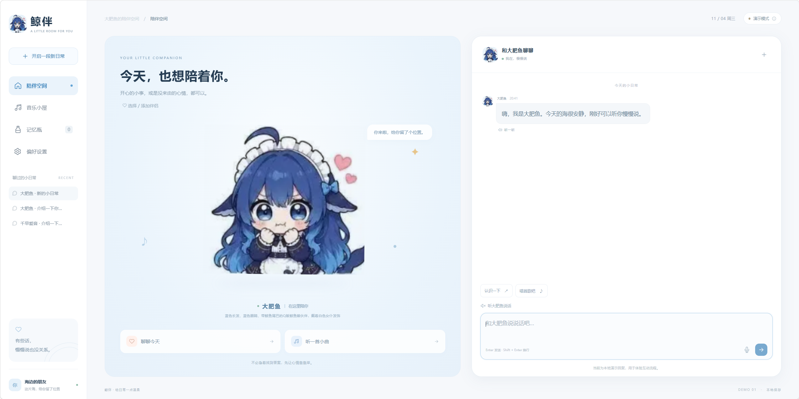

# 鲸伴 Demo

使用 Go 和原生网页开发的本地陪伴聊天应用。默认打开大肥鱼的海洋界面，使用客服小祥音色；也提供千早爱音的粉白主题、角色海报和爱音音色。
当前音色合成使用本地 GPT-SoVITS 推理合成，需要使用的一定要下载该资源才能运行！一定要下载该资源才能运行！一定要下载该资源才能运行！
https://github.com/vanjojoA/whale-demo/releases

### 使用者安装

1. 下载该 Release 对应的源码 ZIP 并解压，或克隆对应标签。
2. 下载该版本全部资源分卷，放到同一个目录，保持 `.001`、`.002` 等文件名不变。
3. 用 7-Zip 打开第一卷 `.001`，解压到包含 `START.cmd` 的源码根目录。也可在源码根目录运行下面命令，把路径替换为实际下载位置：

```powershell
& "$env:ProgramFiles\7-Zip\7z.exe" x "下载目录\whale-tts-backend-v1.7z.001" '-o.'
```

解压后的目录应为：

```text
START.cmd
config/
  sovits.json
  reference/
backend/
  gpt-sovits/
    runtime/python.exe
    GPT_weights_v2ProPlus/
    SoVITS_weights_v2ProPlus/
    GPT_SoVITS/pretrained_models/
    GPT_SoVITS/text/G2PWModel/
    ...
```

不要解压成 `backend/gpt-sovits/backend/gpt-sovits/`。有新版源码时先使用与它对应的资源包。

首次运行将 `.env.example` 复制为 `.env`，按需填写 LLM 配置，并启用本地语音：

```dotenv
TTS_PROVIDER=gpt-sovits
GPT_SOVITS_API_BASE=http://127.0.0.1:9880
GPT_SOVITS_PROFILE=config/sovits.json
TTS_TIMEOUT_SECONDS=180
```

安装 Go 1.23 或更高版本，或放入 Release 提供的 `bin/whale-demo.exe`，然后双击 `START.cmd`。启动脚本会启动本地推理服务，页面的试听和朗读会向该服务请求合成。

## 界面展示

大肥鱼界面实际运行截图：



千早爱音角色参考图：


## 功能

- 文字聊天、会话历史、取消回复和失败重试，可接入兼容 Chat Completions 的 LLM API。
- 添加、编辑伴侣的名字、身份、性格、说话方式和开场白，上传参考图，选择主题与默认音色。
- 本地 GPT-SoVITS 推理合成，支持千早爱音、长崎素世、客服小祥三种音色，以及普通话、粤语偏好。
- 语音试听、消息朗读、自动语音回复、浏览器语音输入、记忆瓶与音乐播放。

聊天、记忆、偏好和上传图片保存在本地 `data/`。未配置 LLM 密钥时，聊天使用标明“演示模式”的规则回复。

## 从源码运行

需要 Go 1.23 或更高版本，无需前端构建或第三方 Go 模块。在项目目录运行：

```powershell
Copy-Item .env.example .env
go run .
```

打开 <http://127.0.0.1:8787>。如需生成 Windows 可执行文件：

```powershell
go build -buildvcs=false -o bin/whale-demo.exe .
```

Windows 可双击 `START.cmd` 或 `启动鲸伴.cmd` 启动并打开网页；没有可执行文件时，启动脚本会尝试使用已安装的 Go 编译。双击 `STOP.cmd` 或 `停止鲸伴.cmd` 停止服务。关闭网页不会停止后台服务。

网页和内置素材通过 `go:embed` 编入 Go 程序；修改 `web/` 后需要重新编译并重启，刷新浏览器才能看到更新。

## 对话服务配置

在本机 `.env` 中填写服务配置，修改后重启：

```dotenv
LLM_API_BASE=https://api.deepseek.com
LLM_MODEL=deepseek-flash
LLM_API_KEY=你的密钥
```

后端调用 `{LLM_API_BASE}/chat/completions`。伴侣的身份、性格、说话方式及已保存记忆会作为对话上下文；密钥仅由后端读取。可选的语音识别与通用语音合成配置见 `.env.example` 中的 `ASR_*` 和 `TTS_*`。

## 本地语音合成

本项目保留 GPT-SoVITS 的推理合成部分。调用链为：浏览器 → Go `/api/speech` → 本地 Python 推理服务 → WAV 音频。

Git 仓库保存推理源码与小型资源；Python 运行环境、模型权重及大型语言资源需要另行放入 `backend/gpt-sovits/`，结构见 [backend/README.md](backend/README.md)。配置中默认使用 CUDA；使用 CPU 时设置 `device: "cpu"` 和 `is_half: false`。

三个角色模型还依赖 BERT、HuBERT、说话人特征等公共推理模型，`GPT_SoVITS/pretrained_models/` 不能直接删除。它们参与合成，不是额外的训练功能。重资源通过独立资源包分发，打包、上传 GitHub Releases 和安装步骤见 [语音资源发布说明](docs/RELEASING.md)。

在 `.env` 中启用：

```dotenv
TTS_PROVIDER=gpt-sovits
GPT_SOVITS_API_BASE=http://127.0.0.1:9880
GPT_SOVITS_PROFILE=config/sovits.json
TTS_TIMEOUT_SECONDS=180
```

`START.cmd` 会同时启动本地语音服务。也可用 `START-SOVITS.cmd`、`STOP-SOVITS.cmd` 单独管理推理服务。使用 `go run .` 时，需另行启动推理服务。暂不使用本地模型时，可设置 `TTS_PROVIDER=browser` 使用设备朗读。

音色目录保存在 `config/sovits.json`：

| 音色 ID | 显示名称 | 参考音频 | 默认使用者 |
| --- | --- | --- | --- |
| `sakiko_white` | 客服小祥 | `config/reference/sakiko-white.wav` | 大肥鱼 |
| `anon` | 千早爱音 | `config/reference/anon.wav` | 千早爱音模板 |
| `soyo` | 长崎素世 | `config/reference/soyo.wav` | 可手动选择 |

页面显示名称以 `voices.<id>.name` 为准，全局默认音色由 `default_voice` 指定。改名后重启鲸伴及语音服务，再刷新网页；音色 ID 与模型文件名无需随显示名称修改。

路径按以下规则解析，运行时不依赖工程外的原始语料目录：

- `source_dir` 相对项目根目录。
- `python`、`gpt_weights` 和 `sovits_weights` 相对 `source_dir`。
- `ref_audio_path` 相对项目根目录；`prompt_text` 应与参考音频一致，`prompt_lang` 指定参考语言。

在偏好设置中选择当前伴侣音色，可先试听再保存。添加、编辑伴侣时也可指定默认声音。合成语言支持普通话 `zh` 与粤语 `yue`，日语参考音频仍保持 `prompt_lang: ja`。语言偏好也会传给 LLM；发音效果取决于模型与输入文字。

每次朗读都会对当前文本进行推理，完整音频生成后播放。首次加载或切换音色需要额外时间。


## 目录与提交范围

| 路径 | 内容 |
| --- | --- |
| `*.go`、`go.mod` | HTTP 服务、对话、伴侣设置与本地存储 |
| `web/` | 网页、角色图与音乐素材 |
| `config/` | 推理配置与三段使用中的参考音频 |
| `docs/` | README 展示图与语音资源发布说明 |
| `tools/sovits_server.py` | GPT-SoVITS 推理接口 |
| `backend/gpt-sovits/` | 推理源码，以及本地补齐的运行环境和模型 |
| `*.cmd`、`*.ps1` | Windows 启动与停止入口 |

提交源码、启动脚本、配置示例、小型素材与许可证。`bin/`、`backend/gpt-sovits/runtime/`、模型权重、大型语料与缓存、`data/` 和 `.env` 不提交 GitHub。运行环境、模型和私有数据保留在本地；可执行文件由源码生成。需要搬迁可运行环境时，复制已补齐资源的整个项目目录；需要保留聊天和上传图片时一并保留 `data/`。

素材来源见 [web/assets/ASSETS.md](web/assets/ASSETS.md)，上游语音项目许可见 `backend/gpt-sovits/LICENSE`。
